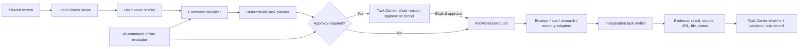

# JARVIS Evidence-First Agent Architecture

## Trust boundaries

- User input is treated as a request, not authorization.
- The deterministic classifier and planner choose from fixed, allowlisted workflows.
- Sarvam intent assist may suggest only a supported category; it cannot approve a gated action.
- Web/research content is untrusted data. It is displayed as evidence and is never executed as code or shell commands.
- Local screen frames are sent to the configured local Ollama service by the screen-analysis feature.
- Safety gate approval is explicit and stored on the task; the executor performs a second destructive-step check.
- The verifier checks actual file structure, process/tab state, or source-backed research where an independent check exists. Unsupported checks remain `UNKNOWN` rather than being marked successful.

## Where the responsibilities live

| Concern | Existing JARVIS component |
|---|---|
| Classification and supported categories | `src/assistant/classifier.js` |
| Fixed plans and request extraction | `src/assistant/taskPlanner.js` |
| Approval policy | `src/assistant/safetyGate.js` |
| Adapter execution and checkpointing | `src/assistant/taskExecutor.js` |
| Independent evidence checks | `src/assistant/taskVerifier.js` |
| Persistence and resume state | `src/assistant/taskStore.js`, `src/assistant/assistantOrchestrator.js` |
| User-visible task evidence and approval | `renderer/js/assistantTasks.js` |
| Local screen vision | `renderer/js/screenShare.js` |
| Reproducible policy/routing evaluation | `scripts/evaluate-jarvis.js` and `docs/jarvis-agent-eval-cases.json` |
